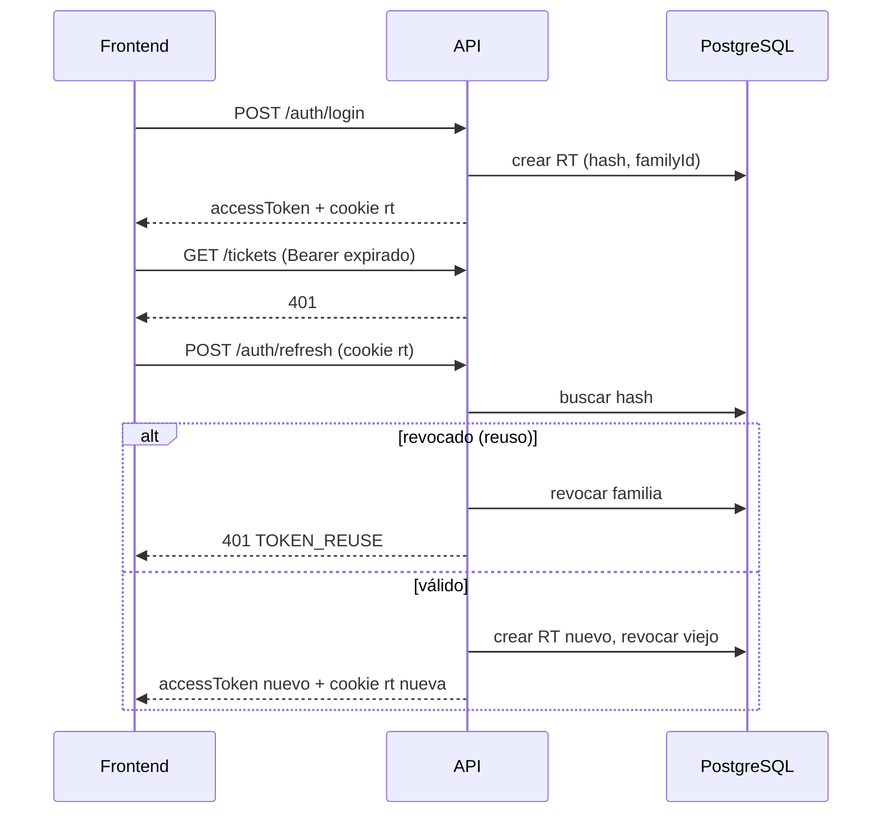
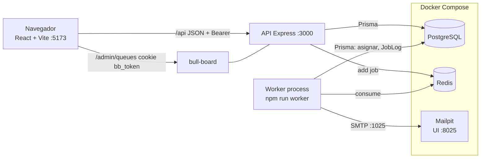
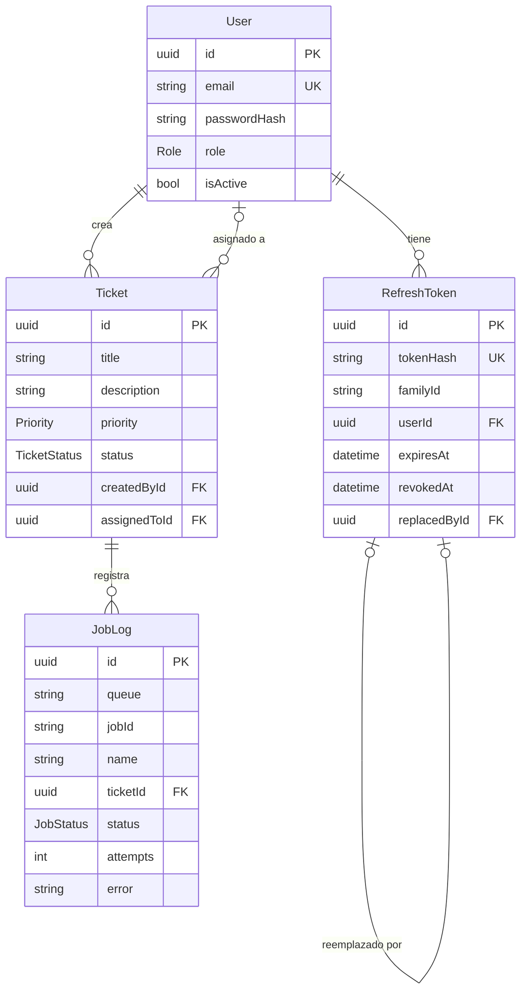

# Arquitectura — HelpDesk Galacticos

## 1. Estructura de carpetas

```
/
├── docker-compose.yml          # postgres:16, redis:7, mailpit
├── docs/ARQUITECTURA.md
├── backend/
│   ├── package.json            # scripts: dev, worker, seed, test, lint
│   ├── .env.example
│   ├── prisma/
│   │   ├── schema.prisma
│   │   └── seed.js             # 1 ADMIN, 2 TECH, 2 CLIENT, tickets de ejemplo
│   └── src/
│       ├── app.js              # express + helmet + cors + rutas + errorHandler
│       ├── server.js           # arranca HTTP
│       ├── worker.js           # arranca workers (proceso separado)
│       ├── config/             # env.js (zod sobre process.env), prisma.js, redis.js, mailer.js
│       ├── routes/             # auth, users, tickets, jobs, admin (bull-board)
│       ├── controllers/        # auth, users, tickets, jobs
│       ├── services/           # auth, token, user, ticket, assignment, notification, jobLog
│       ├── middlewares/        # authenticate, authorize(roles), validate(schema), rateLimit, errorHandler, notFound
│       ├── validators/         # auth, user, ticket, job (zod)
│       ├── queues/             # connection.js, assignment.queue.js, notifications.queue.js, defaults.js
│       ├── workers/            # assignment.worker.js, notifications.worker.js, jobLogEvents.js
│       └── utils/              # AppError, asyncHandler, simulateFailure, emailTemplates
│   └── test/                   # node:test
└── frontend/
    ├── package.json
    ├── vite.config.js          # proxy /api y /admin → :3000
    └── src/
        ├── main.jsx            # QueryClientProvider + Router + AuthProvider
        ├── api/                # client.js (axios + interceptor refresh), auth, tickets, users, jobs
        ├── auth/               # AuthContext.jsx, ProtectedRoute.jsx, RoleRoute.jsx
        ├── schemas/            # zod para formularios
        ├── hooks/              # useTickets, useJobs, useUsers (TanStack Query)
        ├── components/         # Layout, Navbar, TicketCard, StatusBadge, PriorityBadge, JobLogTable
        └── pages/              # Login, Register, TicketList, TicketNew, TicketDetail,
                                # AdminUsers, AdminJobs, NotFound
```

## 2. schema.prisma

```prisma
generator client {
  provider = "prisma-client-js"
}

datasource db {
  provider = "postgresql"
  url      = env("DATABASE_URL")
}

enum Role {
  CLIENT
  TECH
  ADMIN
}

enum Priority {
  LOW
  MEDIUM
  HIGH
  URGENT
}

enum TicketStatus {
  OPEN
  IN_PROGRESS
  RESOLVED
  CLOSED
}

enum JobStatus {
  WAITING
  ACTIVE
  RETRYING
  COMPLETED
  FAILED
}

model User {
  id            String         @id @default(uuid())
  name          String
  email         String         @unique
  passwordHash  String
  role          Role           @default(CLIENT)
  isActive      Boolean        @default(true)
  createdAt     DateTime       @default(now())
  updatedAt     DateTime       @updatedAt

  refreshTokens RefreshToken[]
  ticketsCreated  Ticket[]     @relation("TicketCreatedBy")
  ticketsAssigned Ticket[]     @relation("TicketAssignedTo")

  @@index([role, isActive])
}

model RefreshToken {
  id           String    @id @default(uuid())
  tokenHash    String    @unique          // sha256 del token; nunca el valor plano
  familyId     String                     // misma familia en toda la cadena de rotación
  userId       String
  expiresAt    DateTime
  revokedAt    DateTime?
  replacedById String?   @unique          // token que lo reemplazó al rotar
  createdAt    DateTime  @default(now())

  user       User          @relation(fields: [userId], references: [id], onDelete: Cascade)
  replacedBy RefreshToken? @relation("Rotation", fields: [replacedById], references: [id])
  replaces   RefreshToken? @relation("Rotation")

  @@index([userId])
  @@index([familyId])
}

model Ticket {
  id           String       @id @default(uuid())
  title        String       @db.VarChar(150)
  description  String
  priority     Priority     @default(MEDIUM)
  status       TicketStatus @default(OPEN)
  createdById  String
  assignedToId String?
  createdAt    DateTime     @default(now())
  updatedAt    DateTime     @updatedAt

  createdBy  User     @relation("TicketCreatedBy", fields: [createdById], references: [id])
  assignedTo User?    @relation("TicketAssignedTo", fields: [assignedToId], references: [id])
  jobLogs    JobLog[]

  @@index([createdById])
  @@index([assignedToId, status])   // conteo de carga por técnico
  @@index([status, priority])
}

model JobLog {
  id         String    @id @default(uuid())
  queue      String                    // "ticket-assignment" | "notifications"
  jobId      String
  name       String                    // assign | ticket-created | ticket-assigned | status-changed
  ticketId   String?
  status     JobStatus @default(WAITING)
  attempts   Int       @default(0)
  error      String?
  payload    Json?
  createdAt  DateTime  @default(now())
  updatedAt  DateTime  @updatedAt
  finishedAt DateTime?

  ticket Ticket? @relation(fields: [ticketId], references: [id], onDelete: SetNull)

  @@unique([queue, jobId])
  @@index([ticketId])
  @@index([status, queue])
}
```

## 3. Endpoints REST

Prefijo `/api`. Auth = header `Authorization: Bearer <access>`.

| Método | Ruta | Rol | Descripción |
|---|---|---|---|
| POST | /auth/register | público | Crea usuario CLIENT |
| POST | /auth/login | público (rate-limit) | Devuelve access + cookie refresh |
| POST | /auth/refresh | cookie refresh (rate-limit) | Rota refresh, nuevo access |
| POST | /auth/logout | cookie refresh | Revoca refresh y borra cookie |
| GET | /auth/me | autenticado | Usuario actual |
| GET | /users?role= | ADMIN | Listar usuarios |
| POST | /users | ADMIN | Crear usuario (cualquier rol) |
| PATCH | /users/:id | ADMIN | Cambiar nombre, rol, isActive |
| GET | /tickets?status=&priority= | todos | CLIENT: los suyos; TECH: asignados; ADMIN: todos |
| POST | /tickets | CLIENT, ADMIN | Crea ticket y encola asignación + notificación |
| GET | /tickets/:id | dueño, asignado, ADMIN | Detalle |
| PATCH | /tickets/:id/status | TECH asignado, ADMIN | Cambia estado (encola notificación) |
| PATCH | /tickets/:id/assign | ADMIN | Asignación manual (encola notificación) |
| GET | /tickets/:id/jobs | dueño, asignado, ADMIN | JobLogs del ticket |
| GET | /jobs?queue=&status= | ADMIN | Listado de JobLog paginado |
| GET | /jobs/stats | ADMIN | Conteos por cola/estado (`queue.getJobCounts`) |
| POST | /jobs/:id/retry | ADMIN | Reintenta job FAILED (`job.retry()`) |
| POST | /admin/queues/session | ADMIN | Emite cookie `bb_token` para abrir bull-board |
| GET | /admin/queues (sin /api) | ADMIN (cookie `bb_token`) | Panel bull-board |

Transiciones válidas de estado: `OPEN→IN_PROGRESS→RESOLVED→CLOSED`, `RESOLVED→IN_PROGRESS` (reabrir). Otras → 409 `INVALID_TRANSITION`.

Errores: `{ error: { code, message, details? } }` (`VALIDATION_ERROR` 400, `UNAUTHORIZED` 401, `FORBIDDEN` 403, `NOT_FOUND` 404, `CONFLICT`/`INVALID_TRANSITION` 409, `RATE_LIMITED` 429, `INTERNAL` 500).

## 4. Flujo de autenticación

- **Access token**: JWT `{ sub, role }`, 15 min, firmado con `JWT_ACCESS_SECRET`. Vive solo en memoria (AuthContext).
- **Refresh token**: 64 bytes aleatorios (no JWT), 7 días. Cookie `rt`: `httpOnly`, `sameSite=strict`, `secure` en prod, `path=/api/auth`. En BD solo su hash.

**Login**: validar credenciales (bcrypt, usuario activo) → crear RefreshToken con `familyId` nuevo → responder `{ accessToken, user }` + cookie.

**Refresh (rotación)**: leer cookie → buscar por hash →
1. No existe o expirado → 401 y borrar cookie.
2. **Ya revocado → reuso detectado**: revocar todos los tokens de esa `familyId` (sesión robada queda muerta), 401 `TOKEN_REUSE`.
3. Válido → en transacción: crear token nuevo (misma familia), marcar viejo `revokedAt` + `replacedById` → nuevo access + cookie.

**Logout**: revocar el token actual (y su familia), `clearCookie`. 204.

**Frontend**: al cargar la app llama `/auth/refresh` para restaurar sesión. Interceptor de Axios: ante 401 hace un único refresh compartido (promesa en vuelo para requests concurrentes), reintenta la request; si el refresh falla → logout y `/login`.



## 5. Flujo de colas

Opciones por defecto (ambas colas): `attempts: 3`, `backoff: { type: 'exponential', delay: 2000 }` (2s, 4s), `removeOnComplete: { count: 100 }`, `removeOnFail: false`.

| Evento | Cola / job | Payload | Opciones extra |
|---|---|---|---|
| POST /tickets | `ticket-assignment` / `assign` | `{ ticketId }` | `jobId: assign-<ticketId>` (idempotente), `priority`: URGENT=1, HIGH=2, MEDIUM=5, LOW=10 |
| POST /tickets | `notifications` / `ticket-created` | `{ ticketId, to }` (cliente) | — |
| Worker asigna o PATCH assign | `notifications` / `ticket-assigned` | `{ ticketId, techId }` → correo a técnico y cliente | — |
| PATCH status | `notifications` / `status-changed` | `{ ticketId, from, to }` → correo al cliente | — |

**Worker de asignación** (concurrencia 1 para evitar carreras):
1. `simulateFailure()` → lanza error si `Math.random() < SIMULATE_FAILURE_RATE`.
2. Si el ticket ya tiene técnico → termina (idempotente).
3. Elegir TECH activo con menos tickets `OPEN|IN_PROGRESS` (`groupBy`/`_count`; empate → más antiguo).
4. Sin técnicos → error (reintenta). Actualizar ticket y encolar `ticket-assigned`.

**Worker de notificaciones** (concurrencia 5): `simulateFailure()` → cargar ticket/usuarios → `nodemailer.sendMail` a Mailpit.

**JobLog**: el servicio crea la fila `WAITING` al encolar. Los eventos del Worker la actualizan:
- `active` → `ACTIVE`, `attempts = attemptsMade + 1`
- `failed` con intentos restantes → `RETRYING` + `error`
- `failed` con `attemptsMade >= attempts` → `FAILED` + `error` + `finishedAt`
- `completed` → `COMPLETED` + `finishedAt`

**Al fallar definitivamente**: el job queda en el set *failed* de BullMQ (no se borra) y en JobLog como `FAILED`. Un ticket sin asignar sigue `OPEN` y el ADMIN puede asignarlo a mano. `POST /jobs/:id/retry` → `queue.getJob(jobId).retry()` y JobLog vuelve a `WAITING`. También se puede reintentar desde bull-board.

Limitación aceptada: si Redis cae justo tras crear el ticket, el job no se encola; se responde 201 y queda registrado en log del servidor (no se implementa outbox).

## 6. Diagramas

### Arquitectura



### Entidad-relación


